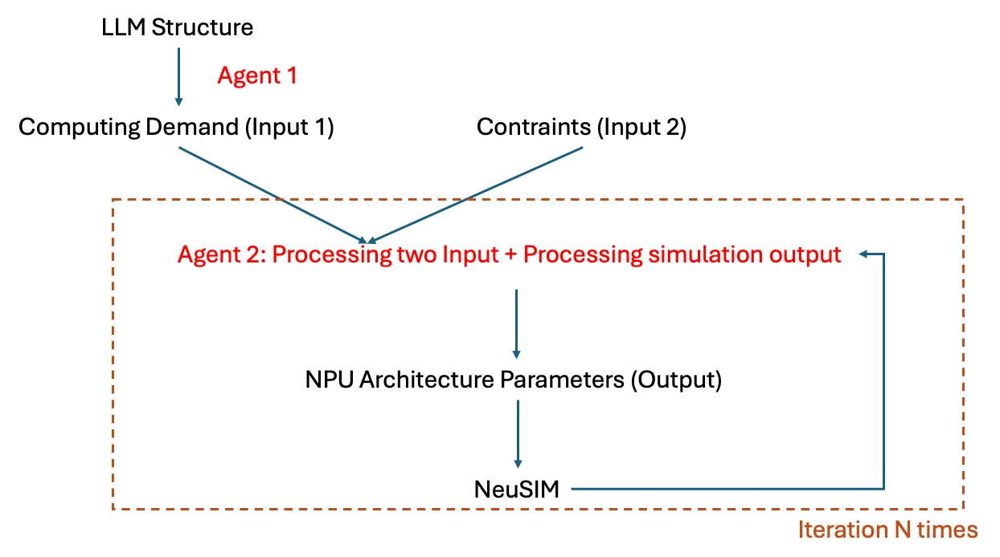

# chip_agent

An LLM-driven NPU architecture design system. Given an LLM model structure and hardware constraints, it automatically designs optimal NPU chip configurations by iterating between an LLM architect (GPT-4o) and the [NeuSim](../NeuSim/) performance simulator.

## System Overview

The system has two agents:

- **Agent 1** (`computedemandagent.py`): Extracts per-operator compute demand from LLM model configs → CSV files
- **Agent 2** (`npudesignagent.py`): Iteratively designs NPU architecture using LLM + NeuSIM simulation loop

```
                          ┌───────────────────────────┐
                          │   LLM Model Config JSON   │
                          │  (llama3-8b, llama2-13b)  │
                          └─────────┬─────────────────┘
                                    │
                     ┌──────────────┴──────────────┐
                     ▼                             ▼
            ┌────────────────┐           ┌─────────────────┐
            │    Agent 1     │           │     Agent 2      │
            │ Compute Demand │           │   NPU Design     │
            │   Extraction   │           │  (this section)  │
            └───────┬────────┘           └─────────────────┘
                    │                              │
                    ▼                              ▼
            ┌────────────┐              ┌───────────────────┐
            │  CSV files │              │  Optimal NPU Chip │
            │ (per-op    │              │   Configuration   │
            │  FLOPs)    │              │  (TTFT/TPOT/Power)│
            └────────────┘              └───────────────────┘
```

---

## Agent 2: NPU Design Method

### Problem Formulation

**Input:**
- LLM model structure (e.g., llama3-8b: 32 layers, d_model=4096)
- Hardware constraints: HBM bandwidth/size, ICI bandwidth, DCN bandwidth (upper bounds)
- Power budget (e.g., 300W hard constraint)
- Parallelism config: num_chips, TP, PP, DP, batch size

**Output:**
- Optimal NPU chip configuration (num_sa, num_vu, sa_dim, freq_GHz, vmem_size_MB, ...)
- Minimizing TTFT (Time To First Token) and/or TPOT (Time Per Output Token)

**Tunable Parameters:**

| Parameter | Description | Range |
|-----------|-------------|-------|
| `num_sa` | Number of systolic arrays | 2 - 16 |
| `num_vu` | Number of vector units | 2 - 12 |
| `sa_dim` | Systolic array dimension (N×N) | 64, 128, 256 |
| `freq_GHz` | Core clock frequency | 0.5 - 2.0 GHz |
| `vmem_size_MB` | On-chip SRAM size | 32 - 512 MB |
| Power params | Per-unit static/dynamic power | Varies |

**Constraints:**
- `total_power_peak_W ≤ power_budget` (hard constraint)
- `memory_footprint ≤ hbm_size_GB` (no OOM)
- `hbm_bw_GBps`, `hbm_size_GB`, `ici_bw_GBps`, `dcn_bw_GBps` ≤ upper bounds

### Method: Seed-Augmented LLM Design Loop

```
┌─────────────────────────────────────────────────────────────────────┐
│                                                                     │
│  Step 1: SEED WARM-START                                            │
│  ┌───────────────────────────────────────────────────────────────┐  │
│  │  9 diverse pre-defined configs spanning the design space      │  │
│  │                                                               │  │
│  │  min-compute ──► low-compute ──► balanced ──► high-compute    │  │
│  │  (2 SA, 0.5G)   (4 SA, 0.8G)   (8 SA, 1.0G)  (12 SA, 1.2G) │  │
│  │                                                               │  │
│  │  Each seed: run NeuSIM → record (TTFT, TPOT, Power, OOM)     │  │
│  │  Find best valid seed as starting point                       │  │
│  └───────────────────────────────────────────────────────────────┘  │
│                              │                                      │
│                              ▼                                      │
│  Step 2: LLM ITERATION LOOP (max 50 iterations)                    │
│  ┌───────────────────────────────────────────────────────────────┐  │
│  │                                                               │  │
│  │  ┌──────────────┐                                             │  │
│  │  │   GPT-4o     │  System prompt:                             │  │
│  │  │  (Architect) │  - Role: NPU chip architect                 │  │
│  │  │              │  - Seed results + best config so far         │  │
│  │  │  Proposes    │  - Parameter ranges & power formula          │  │
│  │  │  new config  │  - Key trade-offs (compute vs memory bound)  │  │
│  │  └──────┬───────┘                                             │  │
│  │         │                                                     │  │
│  │         ▼                                                     │  │
│  │  ┌──────────────┐   Config already tried?                     │  │
│  │  │  Duplicate   ├── YES → reject, ask LLM for different one   │  │
│  │  │  Detection   │                                             │  │
│  │  └──────┬───────┘                                             │  │
│  │         │ NO                                                  │  │
│  │         ▼                                                     │  │
│  │  ┌──────────────┐   ChipConfig.total_power_peak_W > budget?   │  │
│  │  │  Fast Power  ├── YES → reject instantly (no simulation)    │  │
│  │  │  Pre-check   │         tell LLM "reduce by X watts"        │  │
│  │  └──────┬───────┘                                             │  │
│  │         │ PASS                                                │  │
│  │         ▼                                                     │  │
│  │  ┌──────────────┐                                             │  │
│  │  │   NeuSIM     │  Full simulation:                           │  │
│  │  │  Simulation  │  → TTFT, TPOT, Power, Memory footprint      │  │
│  │  └──────┬───────┘                                             │  │
│  │         │                                                     │  │
│  │         ▼                                                     │  │
│  │  ┌──────────────┐                                             │  │
│  │  │  Evaluate &  │  Valid? Update best_result                  │  │
│  │  │  Feedback    │  Feed results back to LLM for next iter     │  │
│  │  │              │  Context trim: keep last 15 iterations      │  │
│  │  └──────┬───────┘                                             │  │
│  │         │                                                     │  │
│  │         ▼                                                     │  │
│  │  Converged? (10 consecutive iters < 2% change) → STOP         │  │
│  │         │ NO                                                  │  │
│  │         └──────────────────────────────► back to GPT-4o       │  │
│  └───────────────────────────────────────────────────────────────┘  │
│                              │                                      │
│                              ▼                                      │
│  Step 3: OUTPUT                                                     │
│  ┌───────────────────────────────────────────────────────────────┐  │
│  │  Best valid config + summary.json + history.json              │  │
│  │  Optional: plot_iterations.py for visualization               │  │
│  └───────────────────────────────────────────────────────────────┘  │
│                                                                     │
└─────────────────────────────────────────────────────────────────────┘
```

### Disaggregated Serving Mode

With `--disaggregated`, the system designs **two separate chips**:

1. **Prefill chip** — optimized purely for TTFT (compute-bound)
2. **Decode chip** — optimized purely for TPOT (memory-bound)

Each chip runs the full seed + LLM iteration loop independently with appropriate optimization weights.

### Key Design Decisions

| Mechanism | Why |
|-----------|-----|
| **Seed warm-start** | LLM (GPT-4o) tends to stay near default configs. Seeds force exploration of the full design space, especially low-frequency / low-compute regions that are often optimal. |
| **Fast power pre-check** | `ChipConfig.total_power_peak_W` is deterministic from config params. Computing it takes ~0.001s vs ~2s for a full NeuSIM simulation. Saves ~30% of wasted iterations. |
| **Duplicate detection** | GPT-4o's reasoning degrades over long conversations and often re-proposes the same config. Hashing config signatures catches this instantly. |
| **Frequency floor (0.5 GHz)** | NeuSIM has a tile-shape selection artifact where TPOT scales linearly with freq (should be flat for memory-bound ops). Capping at 0.5 GHz prevents exploitation. |
| **Context trimming** | OpenAI models have 128k token limits. Keep system prompt + last 15 iteration pairs + best-so-far summary. |

### Scoring Function

For combined optimization:
```
score = ttft_weight × (TTFT / baseline_TTFT) + tpot_weight × (TPOT / baseline_TPOT)
```
Where `baseline_TTFT` and `baseline_TPOT` come from the first valid configuration found. Lower score = better.

---

## Baseline: Grid Search

`baseline_grid.py` provides a brute-force grid search baseline for comparison:

```
Search grid (720 combinations):
  num_sa:       [4, 6, 8, 10, 12]
  num_vu:       [4, 6, 8, 10]
  sa_dim:       [64, 128, 256]
  freq_GHz:     [0.8, 1.0, 1.2, 1.4]
  vmem_size_MB: [128, 256, 384]
```

Same constraints, same scoring, same power budget. Fixed HBM/ICI/DCN at max values.

---

## Experimental Results

All experiments: 8 chips, power budget = 300W, disaggregated mode (separate prefill & decode chips).

### llama3-8b (TP=4, PP=2, BS=16)

| | Grid Search | Agent | Improvement |
|---|---|---|---|
| **Prefill TTFT** | 0.1859 s | **0.1547 s** | **-16.8%** |
| **Decode TPOT** | 7.2406 ms | **4.5256 ms** | **-37.5%** |
| **Simulations run** | 1440 | **82** | **17.6× fewer** |

Best prefill config found by Agent:

| Parameter | Grid Search Best | Agent Best |
|-----------|-----------------|------------|
| num_sa | 8 | **9** |
| sa_dim | 256 | 256 |
| freq_GHz | 0.8 | **0.6** |
| num_vu | 6 | **8** |
| vmem_size_MB | 128 | **512** |
| Peak Power | 277 W | 299 W |

### llama2-13b (TP=4, PP=2, BS=1)

| | Grid Search | Agent | Improvement |
|---|---|---|---|
| **Prefill TTFT** | 0.0373 s | **0.0286 s** | **-23.3%** |
| **Decode TPOT** | 6.3353 ms | **3.9597 ms** | **-37.5%** |
| **Simulations run** | 1440 | **55** | **26.2× fewer** |

Best prefill config found by Agent:

| Parameter | Grid Search Best | Agent Best |
|-----------|-----------------|------------|
| num_sa | 8 | **9** |
| sa_dim | 256 | 256 |
| freq_GHz | 0.8 | **0.54** |
| num_vu | 6 | **5** |
| vmem_size_MB | 128 | **384** |
| Peak Power | 277 W | ~299 W |

### Summary

The Agent method consistently:

1. **Finds better configs** — explores parameter values outside the grid (e.g., `num_sa=9`, `freq_GHz=0.54`) that grid search by definition cannot reach
2. **Uses 17-26× fewer simulations** — seed warm-start + LLM-guided search + power pre-check avoids wasted evaluations
3. **Maximizes power budget utilization** — Agent configs consistently land at ~299W (just under 300W budget), while grid search best configs only reach 277W

> **Note:** Decode TPOT improvements below `freq_GHz=0.8` are partly influenced by a NeuSIM tile-shape selection artifact (`npusim_lib.py:340,951`) where execution time scales linearly with frequency for memory-bound operations.

---

## Agent 1: Compute Demand Extraction



### How It Works

1. Reads a model config JSON (architecture params, parallelism degrees, batch size)
2. Sends the config to GPT-4o, which applies sharding formulas to derive per-operator compute demand
3. Produces operator lists for both **prefill** and **decode** phases
4. A Python-side verification pass recomputes FLOP counts and tensor shapes
5. Outputs two CSV files (`inference_prefill.csv`, `inference_decode.csv`)

### Output Format

Each CSV row represents one operator:

| Column | Description |
|---|---|
| `Description` | Operator name (e.g., `-Q-5`, `FlashAttention-6`) |
| `Count` | Execution count per forward pass |
| `FLOP Count` | Total floating-point operations |
| `Input Tensor Shapes` | Input tensor dimensions with dtype |
| `Output Tensor Shapes` | Output tensor dimensions with dtype |

---

## Setup

```bash
pip install pandas openai python-dotenv matplotlib
```

Create a `.env` file with your OpenAI API key:

```
OPENAI_API_KEY=sk-...
```

## Usage

### Agent 2: NPU Design

```bash
# Basic run (combined TTFT+TPOT optimization)
python npudesignagent.py llama3-8b --chip-version 4 --num-chips 8 \
  --tp 4 --pp 2 --bs 16 --power-budget 300

# Disaggregated mode (separate prefill & decode chips)
python npudesignagent.py llama3-8b --chip-version 4 --num-chips 8 \
  --tp 4 --pp 2 --bs 16 --power-budget 300 --disaggregated

# Custom weights and constraints
python npudesignagent.py llama2-13b --chip-version 4 --num-chips 8 \
  --tp 4 --pp 2 --bs 1 --power-budget 300 \
  --ttft-weight 0.7 --tpot-weight 0.3 \
  --max-hbm-bw 600 --max-hbm-size 16 --max-ici-bw 125 --max-dcn-bw 12.5
```

### Baseline: Grid Search

```bash
python baseline_grid.py llama3-8b --chip-version 4 --num-chips 8 \
  --tp 4 --pp 2 --bs 16 --power-budget 300 --disaggregated
```

### Plot Results

```bash
python plot_iterations.py design_results/<run_dir>/history.json [output.png]
```

### Agent 1: Compute Demand

```bash
python computedemandagent.py ../NeuSim/configs/models/llama3-8b.json --tp 4 --pp 2 --bs 16
```

## Project Structure

```
chip_agent/
├── npudesignagent.py      # Agent 2: LLM-driven NPU architecture design
├── baseline_grid.py       # Grid search baseline for comparison
├── neusim_runner.py       # NeuSIM simulation wrapper (Python API)
├── plot_iterations.py     # Visualization of design iterations
├── computedemandagent.py  # Agent 1: compute demand extraction
├── design_results/        # Output directory for Agent 2 runs
├── results/               # Pre-generated compute demand CSVs
└── .env                   # OpenAI API key (not committed)
```
