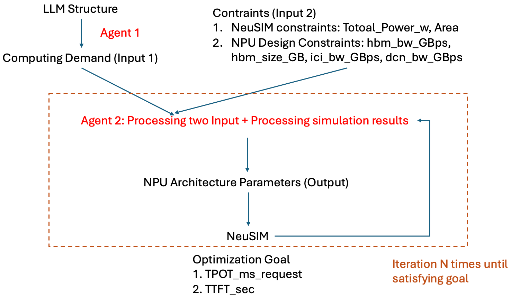

# Multi-Agent System for NPU Architecture Design

A multi-agent system that automatically designs optimal NPU chip configurations for LLM inference. Three LLM agents collaborate with the [NeuSIM](NeuSim/) performance simulator to explore the hardware design space, achieving **19.6% better TTFT** than grid search while using **17x fewer simulations**.



---

## System Architecture

Given an LLM model (e.g., llama3-8b) and hardware constraints (power budget, HBM size, etc.), the system designs an NPU chip configuration that minimizes latency (TTFT / TPOT). Three agents work together in a pipeline:

```
  LLM Model Config
        │
        ▼
  ┌───────────────────────────┐
  │  Agent 1: Compute Demand  │  Runs once before design starts.
  │  Extracts per-operator    │  Output: per-op FLOPs, tensor shapes
  │  workload profile         │
  └─────────────┬─────────────┘
                │
                ▼
  ┌───────────────────────────┐     ┌────────────────────────┐
  │  Agent 3: NPU Design      │◄────│  Design Memory         │
  │  Proposes chip config     │     │  Cross-workload         │
  │  (num_sa, freq, ...)      │     │  experience retrieval   │
  └─────────────┬─────────────┘     └────────────────────────┘
                │                              ▲
                ▼                              │
  ┌───────────────────────────┐                │
  │  NeuSIM Simulation        │                │
  │  → TTFT, TPOT, Power, OOM │                │
  └─────────────┬─────────────┘                │
                │                              │
                ▼                              │
  ┌───────────────────────────┐                │
  │  Agent 2: Bottleneck      │                │
  │  Analysis                 │────────────────┘
  │  One-sentence diagnosis   │     Store experience after
  │  fed back to Agent 3      │     design completes
  └───────────────────────────┘
                │
                └──► Iterate (max 50 rounds) until convergence
```

| Agent | File | Role |
|-------|------|------|
| **Agent 1** | `computedemandagent.py` | Extract per-operator compute demand from model config |
| **Agent 2** | `bottleneck_analysis.py` | Diagnose performance bottleneck from NeuSIM results |
| **Agent 3** | `npudesignagent.py` | Iteratively design NPU architecture via LLM + NeuSIM loop |

All three agents are powered by GPT-4o.

---

## Agent 1: Compute Demand Extraction

**Purpose:** Analyze the LLM model structure and produce a per-operator workload profile that Agent 3 uses to understand what the chip needs to run.

**How it works:**
1. Reads a model config JSON (layer count, hidden dims, attention heads, parallelism degrees)
2. GPT-4o applies sharding formulas to compute per-operator demands under the given parallelism
3. A Python-side verification pass recomputes FLOP counts and tensor shapes
4. Outputs two CSV files: `inference_prefill.csv` and `inference_decode.csv`

**Output format** (each row = one operator):

| Column | Example |
|--------|---------|
| Description | `-Q-5`, `FlashAttention-6` |
| Count | 32 |
| FLOP Count | 2.15e+09 |
| Input Tensor Shapes | `[16, 4096, 1024] bf16` |
| Output Tensor Shapes | `[16, 4096, 1024] bf16` |

---

## Agent 2: Bottleneck Analysis

**Purpose:** After each NeuSIM simulation, diagnose what is limiting performance so Agent 3 can make informed design decisions.

**How it works:**
1. Deterministic extraction: compute time breakdown (Compute / Memory / ICI %), SA utilization, HBM BW utilization, top-5 time-consuming operators
2. GPT-4o summarizes the data into **one sentence** — the core bottleneck fact

**Example output:**
> "Prefill is 78% compute-bound with 42% SA utilization — SAs are under-utilized due to tile padding."

### Why "facts only"?

Agent 2's design went through three iterations. A key finding: **more analysis hurts performance** because detailed recommendations constrain Agent 3's exploration space.

| Version | What Agent 2 outputs | Prefill TTFT |
|---------|---------------------|-------------|
| v1: Detailed | Multi-paragraph with parameter suggestions | 0.1859 s (+20.2%) |
| v2: Concise | 2-3 sentences with parameter values | 0.1637 s (+5.8%) |
| **v3: Facts only** | **One sentence, no recommendations** | **0.1495 s (-3.4%)** |
| No Agent 2 | No bottleneck analysis | 0.1547 s (baseline) |

Agent 2 is deliberately constrained: `temperature=0.1`, `max_tokens=80`, and the system prompt explicitly forbids words like "consider", "recommend", or "should". Agent 3 is the decision-maker.

---

## Agent 3: NPU Design

**Purpose:** The main design agent. Iteratively proposes NPU chip configurations, evaluates them via NeuSIM, and converges to an optimal design.

### Design Space

**Tunable parameters:**

| Parameter | Description | Range |
|-----------|-------------|-------|
| `num_sa` | Number of systolic arrays | 2 - 16 |
| `num_vu` | Number of vector units | 2 - 12 |
| `sa_dim` | Systolic array dimension (N×N) | 64, 128, 256 |
| `freq_GHz` | Core clock frequency | 0.5 - 2.0 GHz |
| `vmem_size_MB` | On-chip SRAM size | 32 - 512 MB |
| Power params | Per-unit static/dynamic power | Varies |

**Hard constraints:**
- `total_power_peak_W ≤ power_budget` (e.g., 300W)
- `memory_footprint ≤ hbm_size_GB` (no OOM)
- `hbm_bw_GBps`, `hbm_size_GB`, `ici_bw_GBps`, `dcn_bw_GBps` ≤ upper bounds

### Design Loop

**Step 1: Seed warm-start.** Evaluate 9 diverse pre-defined configs spanning the design space (from 2 SA / 0.5 GHz to 16 SA / 1.5 GHz). This maps the landscape and gives Agent 3 a strong starting point. Without seeds, GPT-4o tends to stay near default configs and misses counterintuitive regions (e.g., low frequency being optimal).

**Step 2: LLM iteration loop (max 50 rounds).** Each round:
1. Agent 3 (GPT-4o) proposes a new config based on all previous results
2. **Duplicate detection** — if the config was already tried, reject and ask for a new one
3. **Fast power pre-check** — compute `total_power_peak_W` from the config analytically (~0.001s). If it exceeds the budget, reject instantly without running NeuSIM (~2s). Saves ~30% of iterations.
4. **NeuSIM simulation** — run full simulation, get TTFT, TPOT, power, memory footprint
5. **Agent 2 analysis** — one-sentence bottleneck diagnosis
6. **Feedback** — all results + diagnosis fed back to Agent 3

Convergence: stop if the best score doesn't improve by >2% for 10 consecutive iterations.

**Step 3: Reflect & store.** After the loop completes, GPT-4o generates a design lesson from the trajectory, which is stored in the cross-workload design memory.

### Disaggregated Serving

With `--disaggregated`, the system designs **two separate chips**:
1. **Prefill chip** — optimized purely for TTFT (compute-bound)
2. **Decode chip** — optimized purely for TPOT (memory-bound)

Each chip runs the full design loop independently.

### Scoring

```
score = ttft_weight * (TTFT / baseline_TTFT) + tpot_weight * (TPOT / baseline_TPOT)
```

Lower is better. Baseline comes from the first valid seed config.

---

## Cross-Workload Design Memory

**Purpose:** Enable experience transfer across workloads — the key advantage of LLM-based design over Bayesian Optimization.

### Architecture

```
DesignMemory
├── Episodic Memory    Specific design runs with LLM-generated reflections
│     "For llama3-8b prefill, low freq (0.6 GHz) + max SA count was optimal
│      because power savings from low freq funded additional SAs."
│
├── Semantic Memory    General principles consolidated from multiple episodes
│     "Lowering core frequency below 0.7 GHz frees enough power budget for
│      2-3 additional SAs, improving compute-bound workloads."
│
└── Retrieval          Per-chip workload similarity (cosine on feature vectors)
```

### How it works

**After each design run:**
1. GPT-4o reflects on the design trajectory and generates a concise lesson (2-3 sentences)
2. The episode (workload features, best config, results, reflection) is stored in episodic memory
3. When ≥3 episodes exist, GPT-4o consolidates them into general semantic principles

**Before a new design run:**
1. Extract per-chip workload features from the model config and parallelism settings
2. Retrieve the most similar past episodes by cosine similarity
3. Inject retrieved experiences (episodic + semantic) into Agent 3's initial context

### Per-Chip Workload Similarity

The key insight: **optimal NPU config depends on per-chip workload, not model size**. After parallelism sharding:
- llama3-8b with TP=4: per-chip d_ff = 14336/4 = **3584**, heads = 32/4 = **8**
- llama3-70b with TP=8: per-chip d_ff = 28672/8 = **3584**, heads = 64/8 = **8**

Same per-chip workload → same optimal config. Our experiments confirm this (both converge to num_sa=9, sa_dim=256, freq≈0.6 GHz).

Similarity features: `d_ff/TP`, `num_heads/TP`, `num_layers/PP`, `d_head`, `arithmetic_intensity`, `batch_size`, `is_moe`.

---

## Experimental Results

All experiments: power budget = 300W, disaggregated mode (separate prefill & decode chips).

### llama3-8b (8 chips, TP=4, PP=2, BS=16)

**Agent variants comparison (Prefill TTFT):**

| Method | TTFT | vs Grid Search | Simulations |
|--------|------|----------------|-------------|
| Grid Search (720 configs) | 0.1859 s | baseline | 1440 |
| Agent (no Agent 2) | 0.1547 s | -16.8% | ~82 |
| Agent + Agent 2 v1 (detailed) | 0.1859 s | +0.0% | ~82 |
| Agent + Agent 2 v2 (concise) | 0.1637 s | -11.9% | ~82 |
| **Agent + Agent 2 v3 (facts only)** | **0.1495 s** | **-19.6%** | **~82** |

**Best results (Agent v3 vs Grid Search):**

| Metric | Grid Search | Agent (v3) | Improvement |
|--------|-------------|------------|-------------|
| Prefill TTFT | 0.1859 s | **0.1495 s** | **-19.6%** |
| Decode TPOT | 7.2406 ms | **4.5256 ms** | **-37.5%** |
| Simulations | 1440 | ~82 | **17.6x fewer** |

**Best prefill chip config:**

| Parameter | Grid Search | Agent (v3) |
|-----------|-------------|------------|
| num_sa | 8 | **9** |
| sa_dim | 256 | 256 |
| freq_GHz | 0.8 | **0.6** |
| num_vu | 6 | 6 |
| vmem_size_MB | 128 | **256** |
| Peak Power | 277 W | **295 W** |

### llama2-13b (8 chips, TP=4, PP=2, BS=1)

| Metric | Grid Search | Agent | Improvement |
|--------|-------------|-------|-------------|
| Prefill TTFT | 0.0373 s | **0.0286 s** | **-23.3%** |
| Decode TPOT | 6.3353 ms | **3.9597 ms** | **-37.5%** |
| Simulations | 1440 | 55 | **26.2x fewer** |

### llama3-70b (16 chips, TP=8, PP=2, BS=16)

| Metric | Agent (v3) |
|--------|------------|
| Prefill TTFT | 0.6086 s |
| Decode TPOT | 17.3315 ms |
| Best prefill config | num_sa=9, sa_dim=256, freq=0.59 GHz, vmem=420 MB, Power=293 W |

**Cross-workload finding:** llama3-8b (TP=4) and llama3-70b (TP=8) converge to nearly identical configs because their per-chip workloads are the same after sharding. This validates the per-chip similarity metric used in the design memory.

### Key Findings

1. **Better configs** — the agent explores continuous parameter values outside the grid (e.g., num_sa=9, freq=0.54 GHz) that grid search cannot reach
2. **17-26x fewer simulations** — seed warm-start + LLM-guided search + power pre-check avoids wasted evaluations
3. **Full power budget utilization** — Agent configs land at ~295-299 W (just under 300 W budget), while grid search peaks at 277 W
4. **Facts-only bottleneck analysis is optimal** — detailed recommendations from Agent 2 constrain Agent 3's exploration; one-sentence facts let Agent 3 make its own decisions

> **Note:** Decode TPOT improvements below freq=0.8 GHz are partly influenced by a NeuSIM tile-shape selection artifact where execution time scales linearly with frequency for memory-bound operations.

---

## Baseline: Grid Search

`baseline_grid.py` provides a brute-force baseline:

```
Search grid (720 combinations):
  num_sa:       [4, 6, 8, 10, 12]
  num_vu:       [4, 6, 8, 10]
  sa_dim:       [64, 128, 256]
  freq_GHz:     [0.8, 1.0, 1.2, 1.4]
  vmem_size_MB: [128, 256, 384]
```

Same constraints, same scoring, same power budget.

---

## Setup & Usage

### Setup

```bash
pip install pandas openai python-dotenv matplotlib
```

Create `chip_agent/.env`:
```
OPENAI_API_KEY=sk-...
```

### Usage

All commands run from `chip_agent/`:

```bash
cd chip_agent

# Full pipeline (recommended)
python main.py llama3-8b --tp 4 --pp 2 --bs 16 --num-chips 8 --power-budget 300 --disaggregated

# Skip Agent 1 (reuse existing compute demand CSVs)
python main.py llama3-8b --tp 4 --pp 2 --bs 16 --num-chips 8 --power-budget 300 --disaggregated --skip-agent1

# Disable design memory (for ablation)
python main.py llama3-8b --tp 4 --pp 2 --bs 16 --num-chips 8 --power-budget 300 --no-memory

# Run agents individually
python computedemandagent.py ../NeuSim/configs/models/llama3-8b.json --tp 4 --pp 2 --bs 16
python npudesignagent.py llama3-8b --chip-version 4 --num-chips 8 \
  --tp 4 --pp 2 --bs 16 --power-budget 300 --disaggregated \
  --compute-demand-dir results/llama3-8b/dp1-tp4-pp2-dpdcn1-tpdcn1-ppdcn1-bs16

# Grid search baseline
python baseline_grid.py llama3-8b --chip-version 4 --num-chips 8 \
  --tp 4 --pp 2 --bs 16 --power-budget 300 --disaggregated

# Plot design iterations
python plot_iterations.py design_results/<run_dir>/history.json [output.png]
```

---

## Project Structure

```
chip_agent/
├── main.py                # Unified entry point: Agent 1 → Agent 2 → Agent 3
├── main.sh                # Shell wrapper
├── computedemandagent.py  # Agent 1: compute demand extraction (GPT-4o)
├── bottleneck_analysis.py # Agent 2: bottleneck analysis (GPT-4o)
├── npudesignagent.py      # Agent 3: NPU architecture design (GPT-4o + NeuSIM)
├── design_memory.py       # Cross-workload design memory (episodic + semantic)
├── neusim_runner.py       # NeuSIM simulation wrapper (Python API)
├── baseline_grid.py       # Grid search baseline
├── plot_iterations.py     # Visualization of design iterations
├── design_results/        # Output directory for design runs
├── design_memory/         # Persistent cross-workload memory store
├── results/               # Pre-generated compute demand CSVs
└── .env                   # OpenAI API key (not committed)
```
